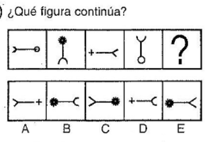
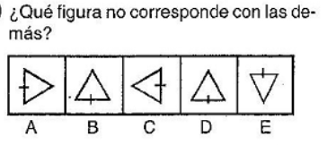
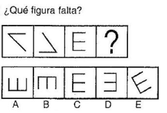
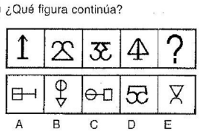
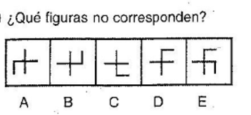
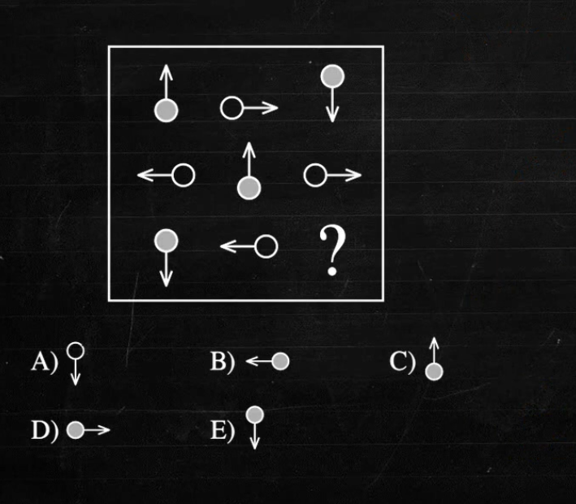
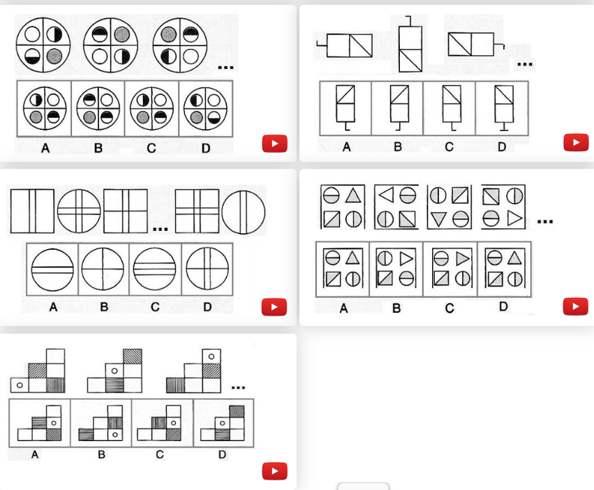

# 🧩 Ejercicios de razonamiento lógico

> 💡 Resuelve cada ejercicio por tu cuenta antes de consultar la solución con tu docente. Las figuras y enunciados están en las imágenes.

## ✏️ Ejercicio 1

## ✏️ Ejercicio 2

## ✏️ Ejercicio 3

## ✏️ Ejercicio 4

## ✏️ Ejercicio 5

## ✏️ Ejercicio 6

## ✏️ Ejercicio 7

## ✏️ Ejercicio 8

## ✏️ Ejercicio 9

## ✏️ Ejercicio 10

## ✏️ Ejercicio 11

## ✏️ Ejercicio 12

## ✏️ Ejercicio 13

## ✏️ Ejercicio 14

## ✏️ Ejercicio 15

## ✏️ Ejercicio 16

## ✏️ Ejercicio 17

## ✏️ Ejercicio 18

## ✏️ Ejercicio 19

## ✏️ Ejercicio 20

> 🚧 Ejercicio para hacer: no tiene solución publicada.
