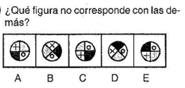
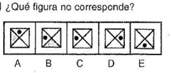
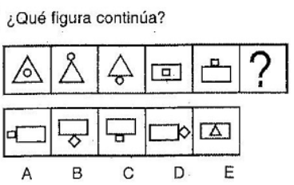
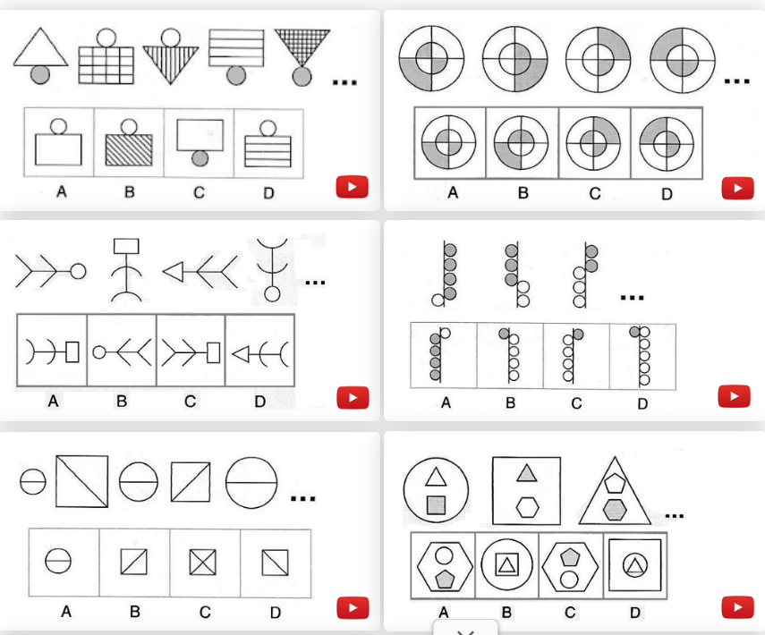

# 🧩 Ejercicios de razonamiento lógico

> 💡 Despliega cada ejercicio con **Mostrar / ocultar** y abórdalos uno por uno. Las figuras y enunciados están en las imágenes.

✏️ Ejercicio 1 — mostrar / ocultar

✏️ Ejercicio 2 — mostrar / ocultar

✏️ Ejercicio 3 — mostrar / ocultar

✏️ Ejercicio 4 — mostrar / ocultar

✏️ Ejercicio 5 — mostrar / ocultar

✏️ Ejercicio 6 — mostrar / ocultar

✏️ Ejercicio 7 — mostrar / ocultar

✏️ Ejercicio 8 — mostrar / ocultar

✏️ Ejercicio 9 — mostrar / ocultar

✏️ Ejercicio 10 — mostrar / ocultar

✏️ Ejercicio 11 — mostrar / ocultar

✏️ Ejercicio 12 — mostrar / ocultar

✏️ Ejercicio 13 — mostrar / ocultar

✏️ Ejercicio 14 — mostrar / ocultar

✏️ Ejercicio 15 — mostrar / ocultar

✏️ Ejercicio 16 — mostrar / ocultar

✏️ Ejercicio 17 — mostrar / ocultar

✏️ Ejercicio 18 — mostrar / ocultar

✏️ Ejercicio 19 — mostrar / ocultar

✏️ Ejercicio 20 — mostrar / ocultar

> 🚧 Ejercicio para hacer: no tiene solución publicada.

