# 🧩 Ejercicios de razonamiento lógico

> 💡 Resuelve cada ejercicio por tu cuenta y luego despliega **Mostrar solución** para comprobar tu respuesta.

## ✏️ Ejercicio 1

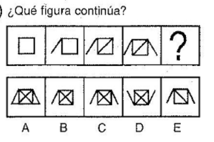

👁️ Mostrar / ocultar solución

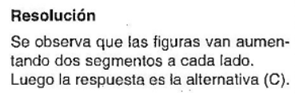

## ✏️ Ejercicio 2

👁️ Mostrar / ocultar solución

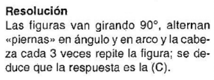

## ✏️ Ejercicio 3

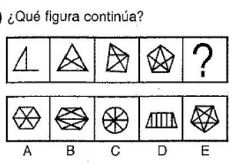

👁️ Mostrar / ocultar solución

## ✏️ Ejercicio 4

👁️ Mostrar / ocultar solución

## ✏️ Ejercicio 5

👁️ Mostrar / ocultar solución

## ✏️ Ejercicio 6

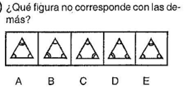

👁️ Mostrar / ocultar solución

## ✏️ Ejercicio 7

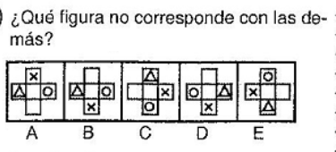

👁️ Mostrar / ocultar solución

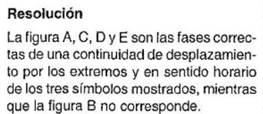

## ✏️ Ejercicio 8

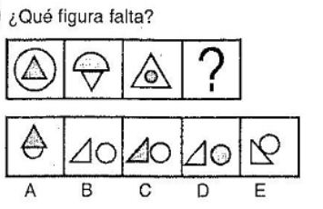

👁️ Mostrar / ocultar solución

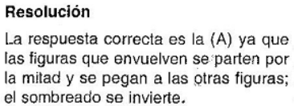

## ✏️ Ejercicio 9

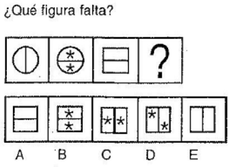

👁️ Mostrar / ocultar solución

## ✏️ Ejercicio 10

👁️ Mostrar / ocultar solución

## ✏️ Ejercicio 11

👁️ Mostrar / ocultar solución

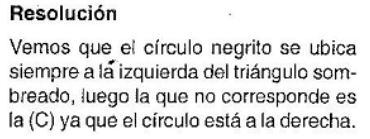

## ✏️ Ejercicio 12

👁️ Mostrar / ocultar solución

## ✏️ Ejercicio 13

👁️ Mostrar / ocultar solución

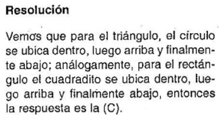

## ✏️ Ejercicio 14

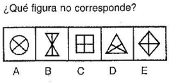

👁️ Mostrar / ocultar solución

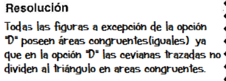

## ✏️ Ejercicio 15

👁️ Mostrar / ocultar solución

## ✏️ Ejercicio 16

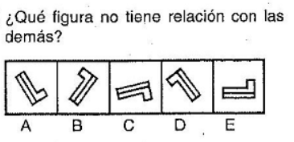

👁️ Mostrar / ocultar solución

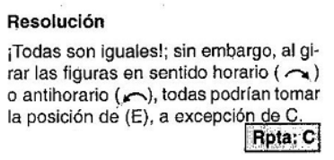

## ✏️ Ejercicio 17

👁️ Mostrar / ocultar solución

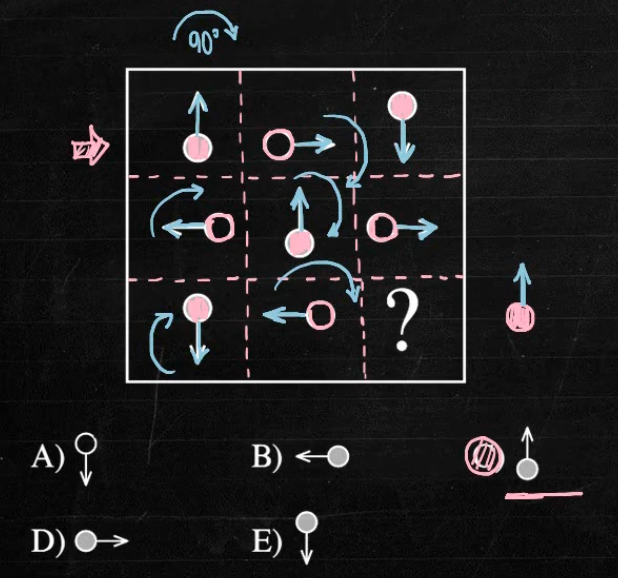

## ✏️ Ejercicio 18

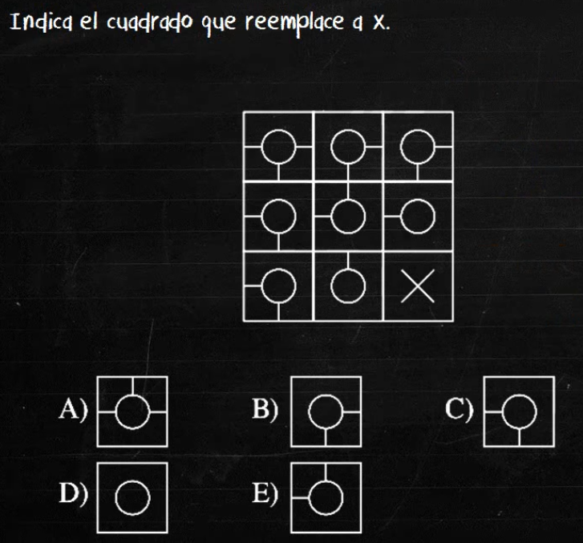

👁️ Mostrar / ocultar solución

## ✏️ Ejercicio 19

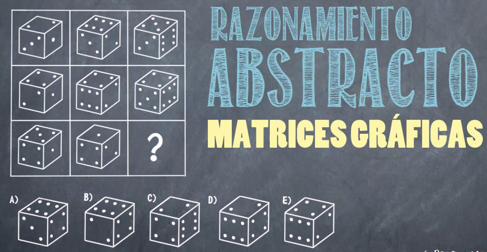

👁️ Mostrar / ocultar solución

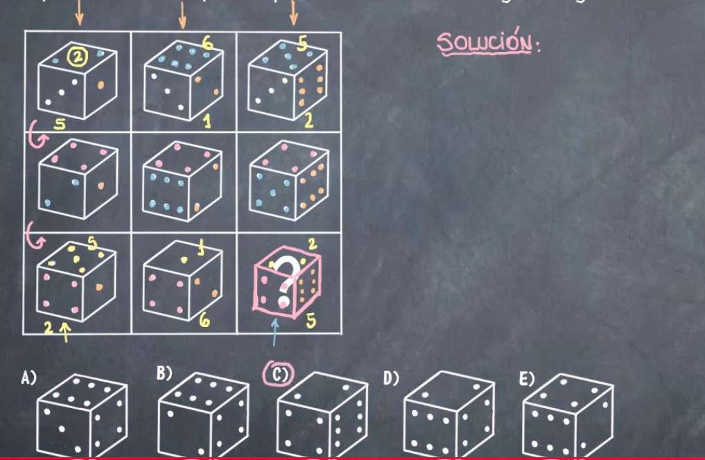

## ✏️ Ejercicio 20

> 🚧 Ejercicio para hacer: no tiene solución publicada.
