# 🔐 Soluciones de razonamiento lógico (material docente)

> 🔒 Uso exclusivo del docente. No compartir con el estudiante.

## Ejercicio 1

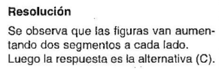

## Ejercicio 2

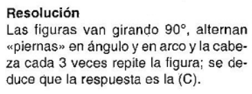

## Ejercicio 3

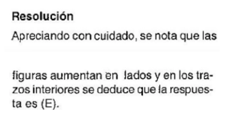

## Ejercicio 4

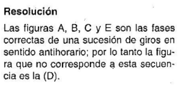

## Ejercicio 5

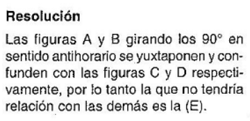

## Ejercicio 6

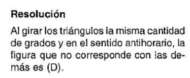

## Ejercicio 7

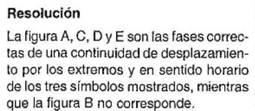

## Ejercicio 8

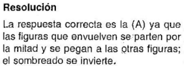

## Ejercicio 9

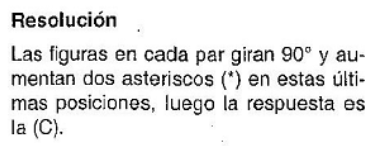

## Ejercicio 10

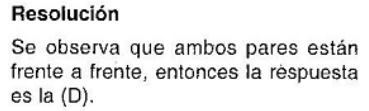

## Ejercicio 11

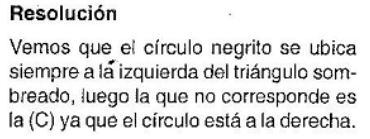

## Ejercicio 12

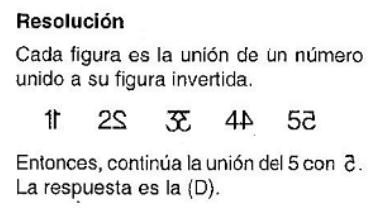

## Ejercicio 13

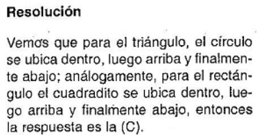

## Ejercicio 14

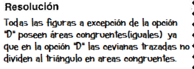

## Ejercicio 15

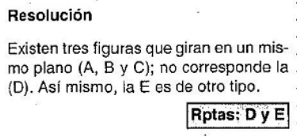

## Ejercicio 16

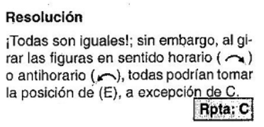

## Ejercicio 17

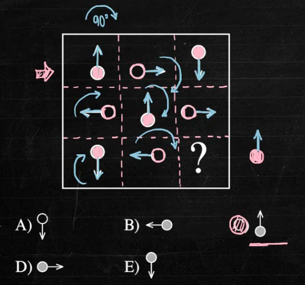

## Ejercicio 18

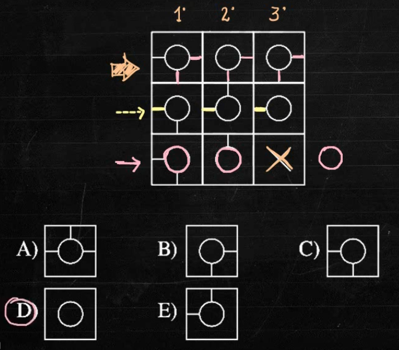

## Ejercicio 19

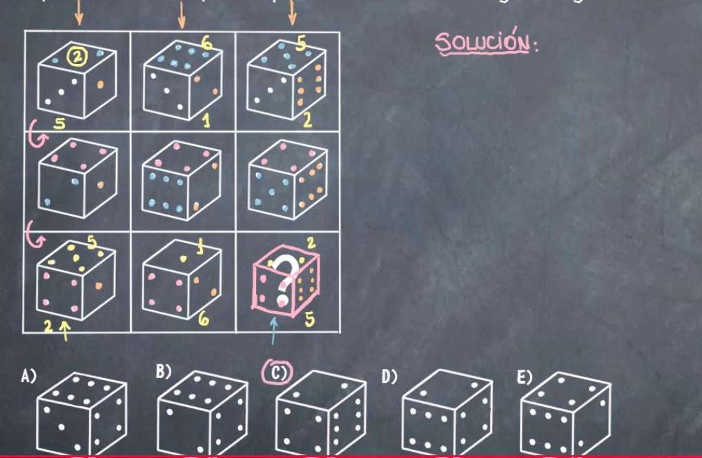
